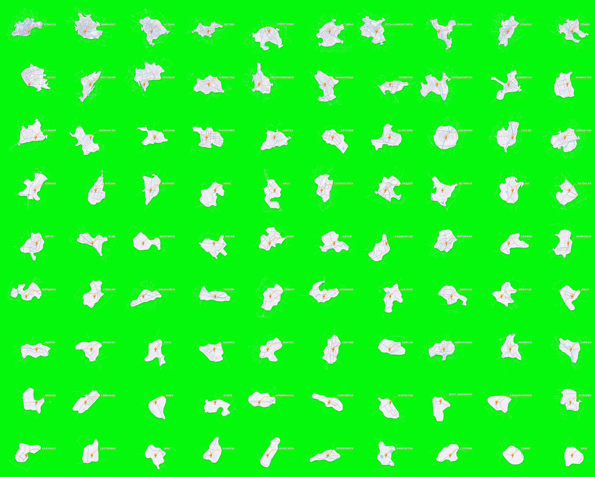

# Мини-карты городов Казахстана для After Effects

90 анимированных мини-карт городов Казахстана в стиле референса: светлая «бумажная» подложка города с улицами,
голубые реки, белые загородные дороги, оранжевый кристалл-маркер, выноска и название города.
Карты построены по реальным данным OpenStreetMap (через Overture Maps), поэтому форма города, улицы и реки
настоящие.



## Что внутри

| Папка | Что это |
|---|---|
| `after-effects/KZ_City_Maps.jsx` | Скрипт для After Effects, собирает анимированные композиции |
| `output/cities/<Город>/plate.png` | Подложка города с улицами (PNG с прозрачностью, 2x) |
| `output/cities/<Город>/map.json` | Векторы (магистрали, реки, загородные дороги, контур) и раскладка |
| `output/video/<Город>.mp4` | Готовые анимации на хромакее, 1920×1080, 25 fps, 6 сек |
| `output/previews/<Город>.jpg` | Стоп-кадры (3-я секунда) |
| `fonts/` | Montserrat (ExtraBold/Bold/Black), лицензия OFL |
| `tools/` | Python-пайплайн: скачивание данных, генерация карт, рендер превью |

Города: все областные центры, города республиканского значения и остальные города (всего 90),
от Алматы до Жема. Полный список с населением в `output/cities/index.json`.

## Быстрый старт в After Effects

1. Скачайте ветку целиком (GitHub → **Code → Download ZIP**) и распакуйте. Структуру папок не меняйте:
   скрипт ищет данные в `../output/cities` относительно себя.
2. Установите шрифт `fonts/Montserrat-ExtraBold.ttf` (двойной клик → «Установить») и перезапустите AE.
3. В After Effects: **File → Scripts → Run Script File…** → выберите `after-effects/KZ_City_Maps.jsx`.
4. В окне выберите города (по умолчанию выбраны все), язык надписи (русский / қазақша / латиница),
   фон (хромакей или прозрачный), FPS и длительность. Нажмите **«Создать»**.

Скрипт создаст в проекте папку **KZ City Maps** с композициями `KZ_Astana`, `KZ_Almaty` и так далее,
а также общую композицию `KZ_ALL_CITIES`, где все города идут подряд. На все 90 городов уходит
несколько минут. Для пробы выберите кнопкой «Топ-20 по населению».

### Как устроена композиция

```
MAP CTRL       null: двигайте и масштабируйте его, чтобы переставить всю карту
PLATE GRP      null: «пружинящий» масштаб подложки
LABEL          название (меняйте текст, линия-выноска подстроится сама)
LINE           оранжевая выноска (Trim Paths)
MARKER         кристалл: падение с отскоком и лёгкое покачивание
MARKER SHADOW  тень под маркером
MAJOR ROADS    магистрали, прорисовка (Trim Paths)
RIVERS         реки, прорисовка (Trim Paths)
PLATE          подложка-PNG, раскрытие круглой маской от центра + Drop Shadow
OUTER ROADS    белые загородные дороги, прорисовка от города наружу
GREEN SCREEN   хромакей (выключите глазок, если нужен прозрачный фон)
```

Тайминг: 0–0,8 с раскрытие подложки; 0,3–1,7 с дороги и реки; 0,75–1,25 с падение маркера;
1,05–1,5 с выноска; 1,25–1,9 с буквы названия выезжают из-под линии; с 5,2 с уход. Все ключи
обычные, их можно двигать. Если поставить другую длительность, уход прилипнет к концу композиции.
Галочка «Анимация ухода» отключает уход, тогда карта просто остаётся в кадре.

Цвета меняются в слоях: обводки и заливки в shape-слоях, цвет текста в LABEL. Подложка сделана
картинкой, её цвет можно подкрутить эффектами (Tint, Curves) на слое PLATE.

Требуется After Effects CC 2018 (15.1) или новее, потому что выноска использует `createPath` в выражении.

## Готовые видео без After Effects

В `output/video/` лежат mp4 на зелёном фоне (цвет как в референсе, RGB 3/248/11). Их можно сразу
ставить на монтаж и кеить. Версия с альфа-каналом (ProRes 4444) весит около 45 МБ на город, поэтому
в репозиторий не положена. Её можно получить командой ниже или рендером из AE с прозрачным фоном.

## Как пересобрать или добавить город (Python)

```bash
pip install pyarrow shapely pyproj scipy scikit-image pycairo pillow numpy
cd tools
python3 fetch_cities.py ../data/localities.json   # список населённых пунктов KZ (уже лежит в data/)
python3 cities.py                                 # отбор городов -> data/cities.json
python3 fetch_data.py                             # дороги и вода по каждому городу (~100 МБ, в data/raw)
python3 render.py --all --video                   # PNG + JSON + превью + mp4 для всех
python3 render.py Astana --alpha                  # дополнительно .mov с прозрачностью
python3 contact.py --overview                     # output/overview.jpg
node ae_mock_test.js                              # сухой прогон JSX-скрипта без AE
```

Чтобы добавить город или посёлок, впишите его русское название в `EXTRA` в `tools/cities.py`
(оно должно совпадать с названием в `data/localities.json`) и повторите шаги с `cities.py`.
Размеры, цвета и тайминги задаются в начале `tools/render.py` (`STYLE`, `T`) и `tools/geo.py`
(`PLATE_SIZE`, `PLATE_MAX`).

Контур подложки строится автоматически по плотности улиц (застроенная территория). Потом он
упрощается до угловатого контура «вырезанной бумаги», а вдоль выездов из города добавляются
«язычки» пригородов.

## Данные и лицензия

Карты: © участники OpenStreetMap, данные доступны по лицензии ODbL, получены через Overture Maps
Foundation (релиз 2026-09-23.1). ODbL требует указывать источник там, где используется карта,
например в титрах: «© OpenStreetMap contributors».
Шрифт Montserrat распространяется по лицензии SIL Open Font License (`fonts/OFL.txt`).
